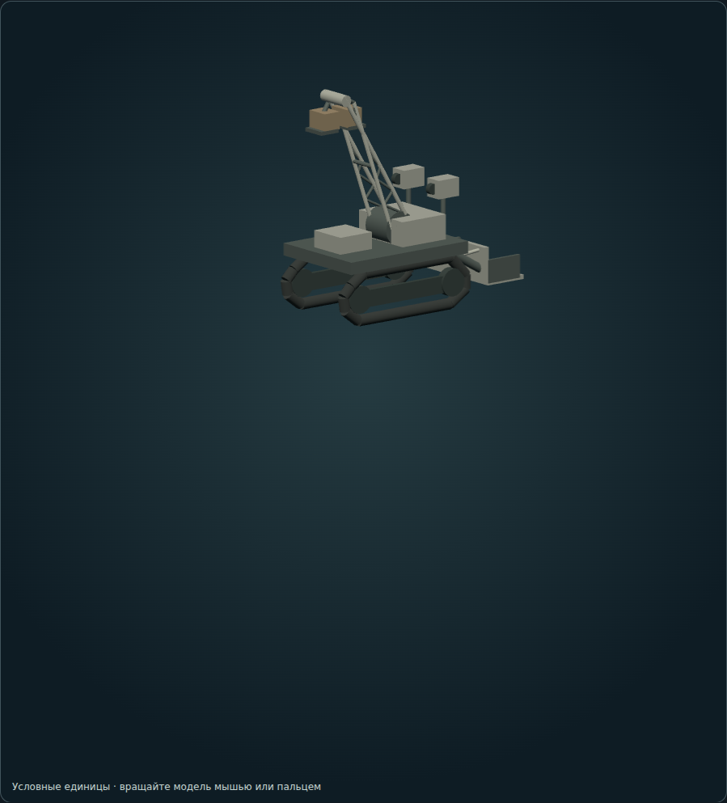
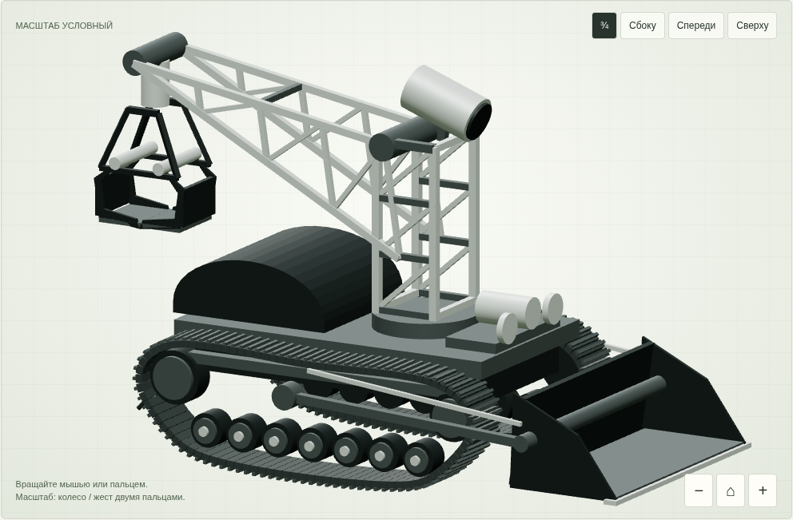
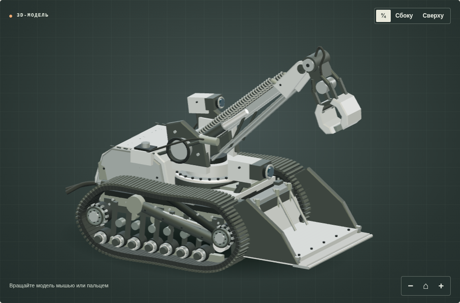
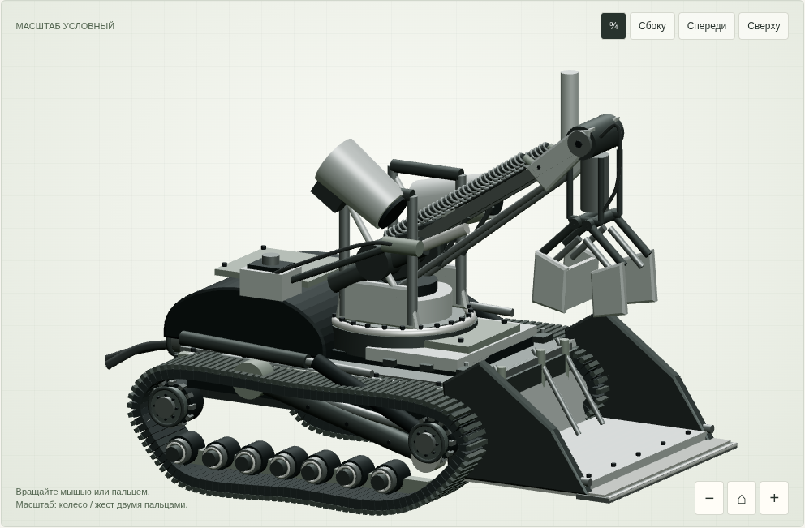

# Что изменилось в двух исследовательских моделях

Подготовлено 17 ноября 2026 для демонстрации 18 ноября. Это реконструкция внешних признаков по источникам, не окончательная исторически точная CAD-модель. Старые версии сохранены; `mobot-latest.html` по-прежнему открывает v17.

## Мобот-Ч-ХВ, 1986: v4 → v5

| Узел | Изменение | Основание | Что не установлено |
|---|---|---|---|
| Ходовая | Открытый борт, семь нижних дисков, поднятые концы, отдельные траки и низкая верхняя ветвь | Рис.6, с.74; B для видимых признаков | Диаметры, оси, подвеска и профиль траков — C |
| Корпус | Арочный кожух вместо условных коробок | Рис.6 и 9; B | Внутреннее устройство и размеры — C |
| Опора и стрела | Высокая решётчатая стойка; две сужающиеся боковые фермы с поперечными связями | Рис.6 и 9; B | Точные сечения, скрытые связи, реальные оси — C |
| Грейфер | Открытая трапециевидная рама, вертикальный подвес, две полые ковшеобразные челюсти | Назначение A по СКТБ, внешний контур B по рис.6 и 9 | Передача и замыкание кинематики — C |
| Погрузчик | Длинные наружные рычаги, открытый широкий ковш, сплошная кромка | Рис.6; B | Точные оси и тяги — C |
| Оборудование | Верхний цилиндрический корпус, низкое оборудование и два круглых фронтальных элемента | Рис.6 и 9; B | Назначение нижних дисков не объявлено подтверждённым |

Грейфер не обязан всегда находиться на конце, противоположном ковшу: на рис.9 он показан со стороны погрузчика. Поворот в модели объясняет две позы; его численный угол остаётся C.

## Мобот-Ч-ХВ-2, 1987: v19 → v20

| Узел | Изменение | Основание | Что не установлено |
|---|---|---|---|
| Верхняя ветвь | Опущена к платформе; убраны произвольные вертикальные перемычки и висящие колпачки | Полный оригинал СКТБ №2 и независимый №4; B | Радиусы и положения колёс остаются C, унаследованными от v19 |
| Корпус | Округлая оболочка кожуха; убраны неподтверждённые плавающие детали | СКТБ №2 и №4; B | Внутренняя компоновка C |
| Опора и стрела | Открытая высокая рама; уточнены относительные наклон и длина стрелы | СКТБ №2 и №4; B для силуэта | Все параметры сцены C |
| Подвес | Головка привязана к реальной конечной оси 3D-стрелы | Проверка координат узлов сцены | Это проверка согласованности модели, не исторического размера |
| Схват | Удлинённая вертикальная головка, открытые связи и широкие пластинчатые губки | СКТБ №2 и фронтальный №3; B | Привод и скрытые оси C |
| Молоток | Вытянутый осевой силуэт и длинный рабочий стержень | СКТБ №9; B | Размеры и крепления C; установка на погрузчик подтверждена лишь текстом A |
| Камеры | Цилиндрические корпуса вместо условных коробок | СКТБ №2 и №4; B | Точные кронштейны и размеры C |

Наличие балансиров подтверждено воспоминанием конструктора; их точная схема не установлена. По умолчанию предполагаемые пары рычагов не показываются. Кабелеукладчик, место вывода кабеля и стыковочная оснастка требуют дальнейшей реконструкции.

Кадры «до/после» сняты реальным WebGL, но камеры разных просмотрщиков не откалиброваны между собой. По ним оценивают видимые изменения, а не численную точность.

## Сверка с архивом

Использованы полные оригиналы и независимые ракурсы. Сохранены [источники и атрибуция](mobot-archive-audit-2026-11-18.md), [контрольные точки 1986](mobot-qa/demo-2026-11-18/fig6-1986-landmarks-manual.json), [контрольные точки 1987](mobot-qa/demo-2026-11-18/sktb-2-landmarks-manual.json), [реестр файлов и SHA-256](mobot-assets/archive/provenance-2026-11-18.json).

[Фотосверка v2](mobot-photo-measure-v2.html) позволяет выбрать оригинал, нанести точки, экспортировать JSON и вручную наложить кадр модели. Масштаб, сдвиг и поворот изображения не заменяют перспективную калибровку. Независимая ошибка репроекции не вычислялась.

## Фактическая проверка

- Настоящие модули Three.js, геометрия, матрицы и вершины проверены в Node. Заглушка Three.js не использовалась. В Node отключено только создание декоративной CanvasTexture.
- WebGL 2 в настоящем Chromium через SwiftShader: две модели на 1440×1000 и 390×844, реальные draw calls и треугольники. Это программный WebGL, не тест физической видеокарты.
- Пройдены пресеты, значения всех регуляторов, переключение трёх инструментов, мышь/эмулированное касание, кнопка масштаба, архивные фотографии и адаптивность. Ошибок консоли и неудачных запросов в этих проходах нет.
- Отдельно сняты v4 и v19 реальным WebGL. Для v19 это загрузка и кадр, не полный тест старого интерфейса.
- Проверен отказ WebGL с переходом к статическому кадру; отдельная резервная страница открывается без JavaScript.
- Пересечений проверенных окружностей нижних/крайних колёс нет. Это только номинальная боковая проекция.
- 162 сочетания поз v5 и 81 сочетание v20 имеют конечные матрицы. 72 и 27 сочетаний соответственно опускают контрольную точку ниже условной плоскости. UI предупреждает об этом; рекомендуемые шесть пресетов проходят проверку контрольных точек.
- Разрыв между концом стрелы и головкой v20 по координатам сцены меньше 10⁻⁹ условных единиц.

Полная проверка mesh-to-mesh столкновений, физическая устойчивость, настоящие телефоны, Safari и VR-шлем не проверены. При произвольном движении возможны взаимные пересечения деталей. Демонстрационные углы не являются эксплуатационными пределами исторической машины.

Отчёты: [v5](mobot-ch-hv-1986-research-v5-qa.json), [v19](mobot-engineering-v19-qa.json), [v20](mobot-engineering-v20-qa.json), [сырой браузерный протокол](mobot-qa/demo-2026-11-18/browser-report.json), [геометрическая проверка](mobot-qa/demo-2026-11-18/scene-report.json).
